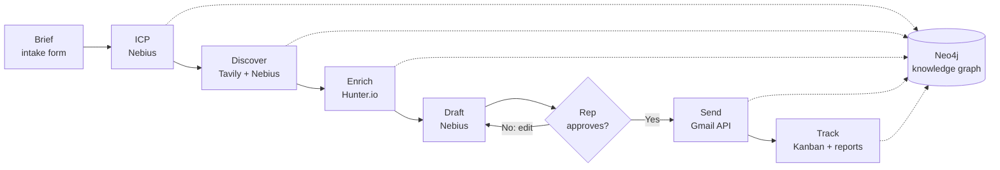

# GTM Office: an AI go-to-market engine

GTM Office turns a plain-language product description into real, sourced leads and personalised outreach that a person approves before it is sent. It replaces five disconnected tools (strategy decks, ad-hoc web searches, enrichment tools, mail clients and pipeline spreadsheets) with one closed loop built on a knowledge graph.

## The problem

Early-stage B2B teams run go-to-market across silos. The ideal customer profile lives in a slide deck, prospects come from scattered searches, contact data sits in a separate tool, and outreach is written by hand in each rep's inbox. Context is lost at every handoff, so targeting drifts, messages turn generic, and customer acquisition gets expensive.

## What GTM Office does

1. A founder describes the product, existing customers and pricing in plain words.
2. The engine infers an **Ideal Customer Profile (ICP)** with a confidence score for every field, and suggests adjacent segments backed by web evidence.
3. It **discovers real companies and named buyers** from public news, filings and company pages. Every company and buying signal links to the source it came from, and anything without a source is discarded.
4. Everything is stored in a **Neo4j knowledge graph** that connects companies, people, signals, competitors, messages and activity, and that finds **warm introduction paths** through your own network.
5. It **finds and verifies business emails** for each buyer.
6. It **drafts an email and a LinkedIn note** for each lead, opening with that company's real trigger event.
7. A rep **approves, edits or rejects** every draft. Nothing is sent without approval.
8. Approved emails are **sent through the Gmail API**, the lead moves along the pipeline, and every action is logged as either AI or rep.

## Pipeline



| Step | What happens | Powered by |
| --- | --- | --- |
| 1. Brief | The founder enters the product, customers and pricing. | Next.js intake form |
| 2. ICP | Industries, company size, buyer personas, trigger events, regions and disqualifiers, each with a 0–1 confidence score. Expansion segments are checked against web evidence. | Nebius, Tavily |
| 3. Discover | Six targeted searches built from the ICP. The model extracts companies, named buyers and dated signals, each tied to a numbered source. A second pass looks up buyers for companies without a named contact. Disqualified and oversized companies are dropped. | Tavily, Nebius |
| 4. Graph | Companies, people, leads, signals and competitors are written to the graph, and your network is linked in for warm paths. | Neo4j |
| 5. Enrich | Email finder for named buyers, finance-department search for companies without one. If Hunter has no data, the engine finds the public LinkedIn profile and proposes the company's email pattern, clearly marked unverified. | Hunter.io, Tavily |
| 6. Draft | One email and one LinkedIn note per lead, built around its strongest signal. Tone adapts to seniority. | Nebius |
| 7. Approve | The human-in-the-loop gate. The rep approves, edits or rejects each draft. | Outbox |
| 8. Send and track | Approved emails go out, the lead moves to Contacted, and the event is attributed to the rep. Reports show funnel conversion, tiers and AI-versus-rep activity. | Gmail API, Neo4j |

### Lead scoring

Each lead gets a fit score from 0 to 100: industry match (up to 30) + company size (up to 20) + buyer persona (up to 20) + buying signals (up to 30).

| Tier | Score |
| --- | --- |
| A | 75 and above |
| B | 50 to 74 |
| C | below 50 |

### Warm introductions

The graph runs a multi-hop query (up to four hops through `WORKS_AT` and `PREVIOUSLY_EMPLOYED_AT`) from a lead's buyer to anyone in your network. For example: *Robert J. Amodei works at AMETEK; Priya Shah (your network) previously worked at AMETEK. Ask Priya Shah for an intro.* Your network lives in `src/data/network.json`.

## Tech stack

| Layer | Technology |
| --- | --- |
| Interface | Next.js, React, Tailwind CSS, shadcn/ui, dnd-kit, Recharts, three.js |
| API | Next.js route handlers, TypeScript, zod, a frozen JSON contract (`src/contract/types.ts`) |
| Intelligence | Nebius Token Factory (Qwen3-30B-A3B Instruct), Tavily search |
| Data | Neo4j AuraDB, the only database: graph, leads, messages, audit events and agent logs |
| Integrations | Hunter.io, Gmail API (OAuth), One (withone.ai) as an alternate email route |
| Delivery | GitHub, Tenki CI runners, Tenki Code Reviewer |

## Architecture

```
Browser (Next.js pages)  ──►  /api routes  (contract: src/contract/types.ts)
                                   │
         ┌─────────────────────────┼─────────────────────────────┐
         ▼                         ▼                             ▼
   Nebius LLM                Tavily search               Hunter.io / Gmail API
   ICP, extraction,          sources and citations       enrichment / sending
   drafts, competitors
         └──────────────►  Neo4j knowledge graph  ◄──────────────┘
              graph, leads, messages, audit events, agent logs
```

The frontend and backend were built in parallel against a frozen API contract. Every response uses the same envelope, every field is always present (unknown values are `null`), and the backend can fall back to fixture data without the frontend changing.

### Graph model

| Nodes | Relationships |
| --- | --- |
| `ICP`, `Product`, `Company`, `Person`, `Lead`, `Signal`, `Competitor`, `Message`, `Event`, `AgentLog`, `DemoSnapshot` | `WORKS_AT`, `PREVIOUSLY_EMPLOYED_AT`, `HAS_SIGNAL`, `MATCHED_TO`, `FOR_PERSON`, `COMPETES_WITH`, `CONTACTED_VIA`, `ABOUT` |

## Getting started

### Prerequisites

Node.js 20 or later, plus accounts for Nebius Token Factory, Tavily, Hunter.io, Neo4j AuraDB (free tier) and a Google Cloud project with the Gmail API enabled.

### Install and run

```bash
git clone https://github.com/rohith-200/GTM-Machine.git
cd GTM-Machine
npm install
cp .env.example .env.local     # then fill in the values below
npm run test-keys              # every line should say OK
node --env-file=.env.local scripts/test-gmail.mjs   # sends one test email
npm run dev                    # http://localhost:3000
```

### Environment variables

| Variable | Purpose |
| --- | --- |
| `NEBIUS_API_KEY` | Nebius Token Factory key |
| `NEBIUS_MODEL` | A non-reasoning instruct model, e.g. `Qwen/Qwen3-30B-A3B-Instruct-2507` |
| `TAVILY_API_KEY` | Tavily search |
| `HUNTER_API_KEY` | Hunter.io |
| `NEO4J_URI`, `NEO4J_USER`, `NEO4J_PASSWORD` | AuraDB credentials (`NEO4J_USER` is the `NEO4J_USERNAME` value from the Aura credentials file) |
| `GMAIL_CLIENT_ID`, `GMAIL_CLIENT_SECRET`, `GMAIL_REFRESH_TOKEN` | Gmail API OAuth credentials with the `gmail.send` scope |
| `EMAIL_PROVIDER` | `gmail` (default when a Gmail refresh token is set) or `one` |
| `TEST_INBOX` | Every approved email is delivered here |
| `SEND_TO_REAL` | Leave unset. Only `true` would email real prospects |
| `SENDER_NAME` | Sign-off name used in drafts |
| `USE_FIXTURES` | `true` makes every route return sample data |
| `ONE_API_KEY`, `ONE_GMAIL_CONNECTION_KEY`, `ONE_GMAIL_SEND_ACTION_ID`, `ONE_GMAIL_SEND_PATH` | Optional, only for sending through One |

## API

Every response is `{ "ok": true, "data": ... }` or `{ "ok": false, "error": { "code", "message" } }`.

| Method | Path | Purpose |
| --- | --- | --- |
| `POST`, `GET` | `/api/icp` | Generate or read the ICP |
| `POST` | `/api/icp/segment` | Accept or dismiss an expansion segment |
| `POST` | `/api/discover` | Run discovery for an ICP |
| `GET` | `/api/leads` | All leads, sorted by fit score |
| `GET` | `/api/competitors` | Competitor analysis |
| `POST` | `/api/enrich` | Find and verify contact details |
| `POST` | `/api/drafts` | Draft outreach for selected leads |
| `GET` | `/api/messages?status=` | The approval queue |
| `POST` | `/api/messages/review` | Approve, edit or reject a draft |
| `POST` | `/api/leads/stage` | Move a lead on the pipeline board |
| `GET` | `/api/graph/warm-paths?leadId=` | Warm introduction paths |
| `GET` | `/api/activity` | Audit log with AI or rep attribution |
| `GET` | `/api/agent-log?since=` | Live reasoning steps for the Agent Thinking panel |
| `GET` | `/api/analytics` | Funnel, conversion, tiers and attribution |
| `POST` | `/api/demo/save`, `/api/demo/load` | Save or restore a complete demo run |
| `POST` | `/api/graph/link-network` | Re-link `src/data/network.json` |

## Project structure

```
src/
  app/                 pages (intake, ICP, leads, outbox, pipeline, reports) and /api routes
  components/          workspace screens, shared badges, office scene
  contract/            frozen API types and sample fixtures
  data/network.json    your network, used for warm introductions
  lib/
    icp.ts             ICP inference and evidence
    discover.ts        search, extraction, filtering, scoring
    repo.ts            Neo4j reads and writes
    network.ts         network linking and warm-path queries
    hunter.ts          enrichment and fallback
    outreach.ts        draft generation
    gmail.ts           Gmail API sending
    mailer.ts          email provider switch
    snapshot.ts        demo save and restore
scripts/
  test-keys.mjs        checks every API key
  test-gmail.mjs       sends one test email
```

## Safety and trust

Approved emails go to `TEST_INBOX` by default, with a header naming the intended recipient, so no real prospect is contacted during demos. Every signal and contact links to its public source, and unverified email guesses are labelled as such. Nothing is sent without a rep's approval, and every outbound action is recorded with who did it and when.

## Built with

Nebius, Tavily, Neo4j, Hunter.io, the Gmail API, One and Tenki, built in a single hackathon day.
